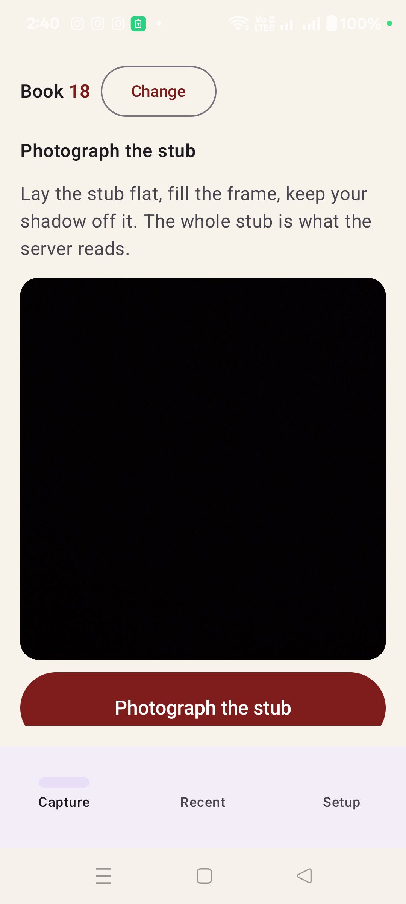
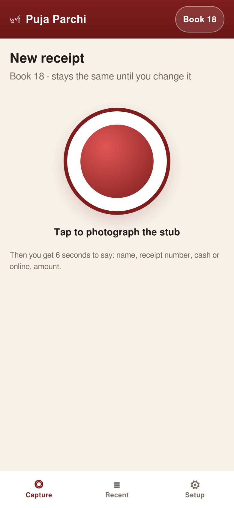
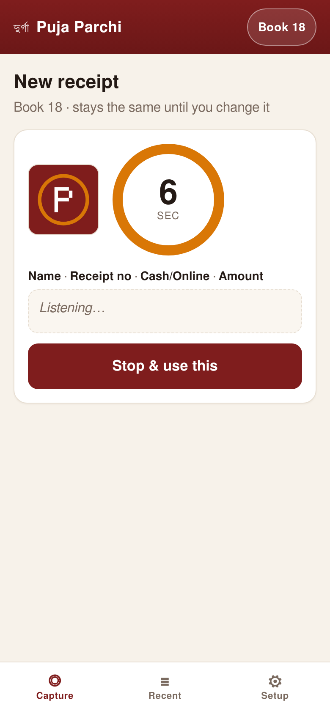
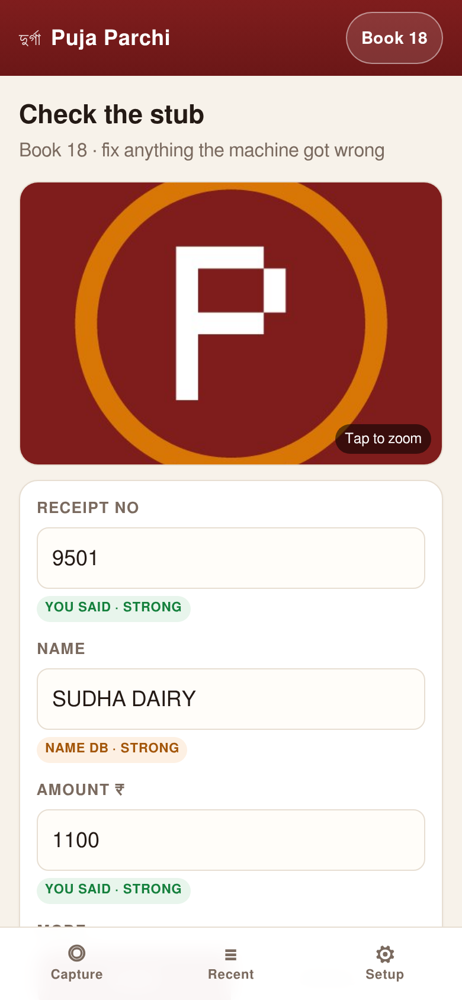
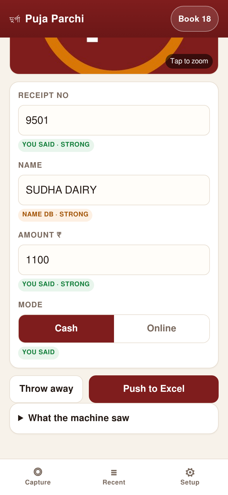
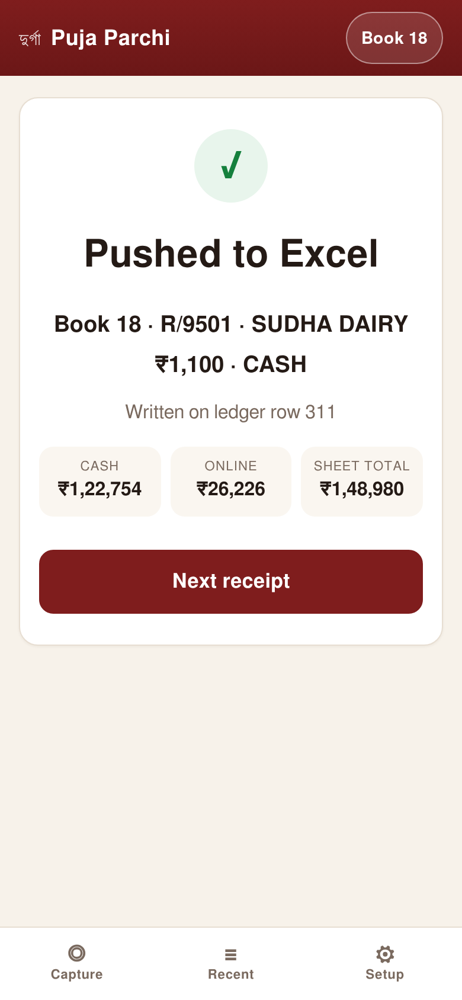
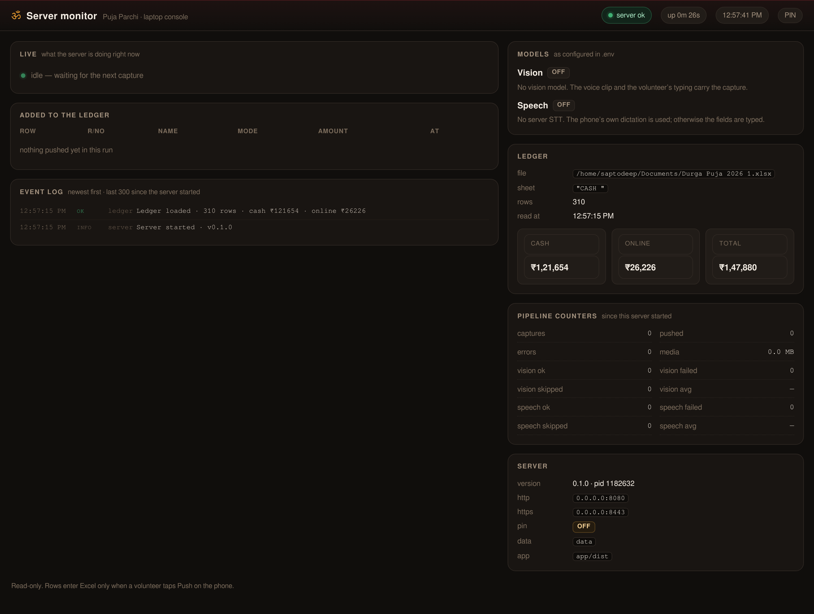
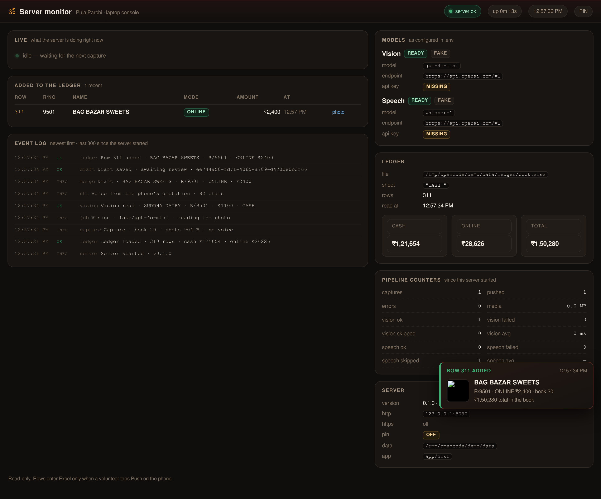
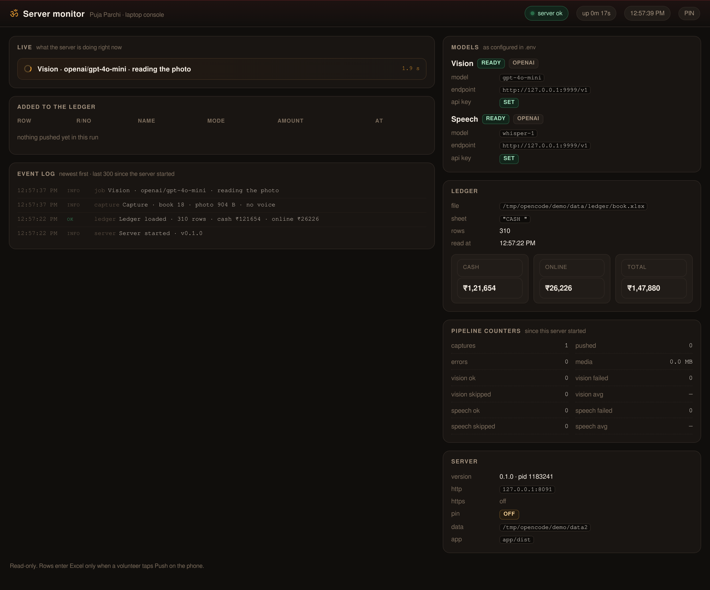

# Puja Parchi

Photograph a receipt stub, check four fields, push one clean row into the Durga Puja
ledger. Rust server + native Android app. Runs on one laptop, on the pandal wifi, with
no cloud account required.

```
phone (app / browser) ──►  Rust server  ──►  Durga Puja 2026.xlsx
                                │
                                ├──► data/photos/<book>/…
                                ├──► data/audio/<book>/…   (browser app only)
                                └──► data/puja.db  (drafts + sticky book)
```

## Quick start (laptop)

```bash
cd durga-puja-2026
./scripts/dev.sh
```

First run installs the app build, starts the server on `:8080` (http) and `:8443` (https),
and prints the URLs to use on the phone.

Defaults: writes to `data/ledger/Durga Puja 2026.xlsx`. To write your live book instead,
set `PUJA_LEDGER_PATH` (see `.env.example`).

`dev.sh` starts the reading and speech models too, so starting the server also means the
models are loaded. Set `PUJA_MODELS=off` to skip that (for a cloud provider).

## Local models (no cloud account)

The reading model runs on the laptop, so the stub never leaves the building. Speech does too,
for the browser app that still captures a clip.

```bash
# vision - ollama (already installed for this laptop under ~/.local)
~/.local/ollama/bin/ollama serve &

# speech - whisper.cpp server on Vulkan, 16 kHz audio in, text out
~/.local/src/whisper.cpp/build-vulkan/bin/whisper-server \
  -m ~/.local/src/whisper.cpp/models/ggml-small.bin \
  --host 127.0.0.1 --port 8081 --convert \
  --inference-path /v1/audio/transcriptions -t 8
```

`./scripts/dev.sh` does the above for you and skips whatever is already running:

```bash
./scripts/models.sh          # start anything not already up (and keep the model warm)
./scripts/models.sh status   # what is answering right now
./scripts/models.sh stop     # stop the ones this script started
```

The server also probes both endpoints at boot and records the result in the monitor, and
`/api/health` reports `vision_ready` / `stt_ready`, so "configured but not running" is
visible on the Setup screen and in the console instead of being discovered at the first
capture.

### Which model, and why (measured on this laptop)

| | Where it runs | VRAM | Host RAM | Time per clip |
|---|---|---|---|---|
| Vision `gemma3:4b` | RTX 3050, 100% GPU | 3.7 GB | ~1.1 GB | ~5.3 s |
| Speech `ggml-small.bin` | RTX 3050 via Vulkan | 0.78 GB | 0.21 GB | ~0.25 s |
| | **both at once** | **4.5 of 6.1 GB** | **~1.3 GB** | **5.6 s end to end** |

Both models live on the one 6 GB card, which is why speech is piped through **Vulkan**
rather than the CPU: on the CPU it cost 3.1 s of a 12-core laptop's attention per clip and
0.68 GB of RAM, on the GPU it costs 0.25 s and 0.21 GB. Vision is now the whole wait.

The native app sends the stub and nothing else, so a real capture on it is the vision number
alone — **4.0 s** measured, against 5.5 s when a six-second clip came with the photo. The
speech row above is only in play for the browser fallback.

Speech stays **small**, not `large-v3-turbo`, but no longer for speed — on the GPU turbo is
0.30 s too. It is VRAM: turbo's model takes 1.83 GB against small's 0.78 GB, and next to
gemma's 3.7 GB that leaves 0.5 GB of headroom instead of 1.6 GB. On the real clip both say
the same words ("Atharvasingh 866" vs "Atherv Singh 866"), and the name gazetteer repairs
the spelling either way. Set `WHISPER_MODEL=…/ggml-large-v3-turbo.bin` if you want it and
watch the VRAM.

Together the two models want about **1.3 GB of RAM and 4.5 GB of VRAM**. On a 15 GB laptop
with a browser open, running out is the one thing that makes the whole desk feel broken, so
`models.sh` warns before it starts if less than 1.5 GB of RAM is free. The vision model is
released again after `PUJA_KEEP_ALIVE` (default `15m`) with no captures, which hands back
its 1.1 GB and 3.7 GB of VRAM. If you are still tight: `pkill -f GradleDaemon` frees the
~1 GB an old Android build leaves behind.

### Building the Vulkan whisper (once per laptop)

No CUDA toolkit is needed and nothing here wants root — the driver, `glslc` and the Vulkan
loader are already on this machine; only Khronos' SPIR-V headers were missing, and they are
a header-only git clone:

```bash
git clone --depth 1 https://github.com/KhronosGroup/SPIRV-Headers ~/.local/src/SPIRV-Headers

cd ~/.local/src/whisper.cpp
cmake -B build-vulkan -DCMAKE_BUILD_TYPE=Release -DGGML_VULKAN=ON -DGGML_NATIVE=ON \
  -DGGML_OPENMP=ON -DBUILD_SHARED_LIBS=ON -DWHISPER_BUILD_EXAMPLES=ON \
  -DWHISPER_BUILD_SERVER=ON \
  -DSPIRV-Headers_DIR="$HOME/.local/cmake" \
  -DCMAKE_CXX_FLAGS="-I$HOME/.local/src/SPIRV-Headers/include"
cmake --build build-vulkan --target whisper-server -j 8
```

`~/.local/cmake/SPIRV-HeadersConfig.cmake` is a three-line stand-in for the root-only
`spirv-headers` package: ggml only calls `find_package(SPIRV-Headers CONFIG REQUIRED)` as an
existence check, so the include path is passed by the flag above. The build prints
`Found 1 Vulkan devices: 0 = NVIDIA GeForce RTX 3050 6GB` and `using Vulkan0 backend` on
startup; `models.sh` prefers `build-vulkan/bin/whisper-server` whenever it exists and falls
back to the CPU build in `build/bin`. The CPU build is kept for exactly that reason.

## Phone app (Kotlin)

The phone app is native Android, in `android/`. No browser, no certificate: an app is
allowed to talk to the laptop over plain http, so it uses `http://<laptop-ip>:8080`.

```bash
cd android
./gradlew assembleDebug
adb install -r app/build/outputs/apk/debug/app-debug.apk
```

First run: type the laptop address (for example `http://192.168.0.110:8080`), the PIN if
the server has one, and tap **Save and test** — it reports the vision model, the speech
model and whether the ledger was found. Then set the receipt book number, which stays
fixed until you change it.

**The capture is one photo.** Nothing is spoken: the app asks for the camera and no
microphone, records nothing, and uploads nothing but the stub. The receipt already has the
name, the receipt number and the amount written on it, so the vision model reads the paper
and the review screen is where a human fixes whatever the handwriting cost. One upload, one
wait, one draft back.

That is not how it started — the first version recorded six seconds of speech per receipt,
with the four values read aloud in order. It was removed on the operator's own evidence
after three real receipts: the transcripts came back as `'Sunita 86800 cash.'` and
`'We reigned the Singh 5867'`, a field had to be retyped by hand on two of the three, and
the numbers that did survive came from the photo anyway. The photo is more accurate and
about 1.5 s faster, and nobody has to remember an order while a queue waits.

## Phone (browser fallback)

The same server still serves the installable web app; it is the fallback if the phone
cannot run the APK.

1. Same wifi as the laptop.
2. `https://<laptop-ip>:8443/ca.crt` → download the certificate.
3. Android: Settings → Security → Encryption & credentials → Install a certificate →
   **CA certificate** → pick the download. (iOS: install the profile, then enable it under
   Settings → General → About → Certificate Trust Settings.)
4. Open `https://<laptop-ip>:8443` → browser menu → **Add to home screen**.
5. In Setup: set the receipt book number. It stays set until you change it.

> The mic only works over HTTPS with a trusted certificate — that is a browser rule, not
> this app's choice. Without step 2 the app still photographs and lets you type.
>
> **The browser app still asks for six seconds of speech**; only the native app dropped it.
> The server keeps its speech path for this fallback, which is also why whisper.cpp still
> loads at startup. If nobody uses the browser any more, set `PUJA_MODELS=off` and start the
> server yourself with `ollama serve` — or leave it, since the fallback is the reason it is
> there.

## Screens

The native app's whole capture is one screen — no script, no clock, no microphone:

| Android: capture |
|---|
|  |

The browser app (the fallback) does the same job with six seconds of speech:

| Capture | 6-second voice | Review | Review (bottom) | Pushed |
|---|---|---|---|---|
|  |  |  |  |  |

## Using it

**Native app** — set the book number, tap the shutter, check the four fields, push. That is
the whole loop; there is nothing to say out loud.

**Browser app** — the same loop, with a spoken clip as a second reading:

1. **Capture** — tap the big shutter, photograph the stub.
2. **Speak** — you get 6 seconds, or tap *Stop & use this* early: *name · receipt no ·
   cash/online · amount*.
3. **Check** — receipt, name, amount, mode are pre-filled with badges showing where each
   value came from. Warnings show any disagreement. Fix anything; edits are final.
4. **Push** — writes one row to the bottom of `CASH `, shows the row number and totals.

Nothing is written to Excel until you tap Push. Photos are saved before any model sees them —
and so is the clip, in the browser app.

## Server monitor (laptop)

A second, read-only console for the laptop — not the phone app:

```
http://127.0.0.1:8080/monitor          # same machine
https://<laptop-ip>:8443/monitor       # from anywhere on the wifi
```

| Console | Row added (pop-up) | Model call in flight |
|---|---|---|
|  |  |  |

- **Live** — the model call happening right now (*Vision · openai/gpt-4o-mini · reading the
  photo*) with a running clock, so you can see the server working a capture.
- **Added to the ledger** — the last ten committed rows, each with a link to its stub photo.
- **A pop-up** the moment a row lands in Excel: name, receipt, mode, amount, row number and
  the new book total.
- **Event log** — every stage of every capture since the server started, newest first, last
  300 lines: capture → vision → speech → merge → draft → ledger; failures in amber and red.
- **Models** — the provider and model actually in use, the endpoint, whether an API key is set.
- **Sheet** — a live preview of the workbook itself: the tail of the real sheet, newest
  first, with the same six columns as the book (Book, R/No, Name, Cash, Mode, Online).
  Pre-printed stubs are dimmed, and a row pushed during this run is green — the box scrolls
  to it, because a push lands in the pre-printed line for its receipt, which can sit many
  rows above the end of the book. It is re-read when the sheet changes (boot and after each
  push), not on every poll, so scrolling and selecting are not interrupted.
- **Ledger, counters, server** — file, sheet, rows, cash/online/total, throughput, average
  model latency, version, pid, listeners, PIN state.

It uses the same PIN as the phone (`PUJA_PIN`); the page asks once and remembers it, or take
`/monitor?pin=1234`. With no PIN set it opens directly — the page itself holds no data, so it
loads before the PIN is typed and everything it shows comes from the guarded API behind it.

The console is in-memory on purpose: it reports what happened since this server started. The
workbook and `data/puja.db` stay the record.

## Configuration

| Variable | Default | Meaning |
|---|---|---|
| `PUJA_DATA_DIR` | `data` | photos, audio, db, certs |
| `PUJA_LEDGER_PATH` | `data/ledger/Durga Puja 2026.xlsx` | the workbook to append to |
| `PUJA_LEDGER_SHEET` | `CASH ` | sheet name (trailing space is real) |
| `PUJA_ADDR` | `0.0.0.0:8080` | http listener |
| `PUJA_TLS_ADDR` | `0.0.0.0:8443` | https listener |
| `PUJA_TLS` | `on` | `off` disables https (the browser app's mic then won't work) |
| `PUJA_PIN` | unset | if set, the app demands this PIN (header `x-pin`, or `?pin=` for photos) |
| `PUJA_VISION_PROVIDER` | `none` | `none` · `openai` · `fake` |
| `PUJA_VISION_BASE_URL` | `https://api.openai.com/v1` | any OpenAI-compatible endpoint; the local ollama is `http://127.0.0.1:11434/v1` |
| `PUJA_VISION_API_KEY` | unset | provider key |
| `PUJA_VISION_MODEL` | `gpt-4o-mini` | vision model id (local: `gemma3:4b`) |
| `PUJA_STT_BASE_URL` | same as vision | speech endpoint, when the transcription server is elsewhere (local: `http://127.0.0.1:8081/v1`) |
| `PUJA_STT_API_KEY` | same as vision | key for the speech endpoint |
| `PUJA_STT_MODEL` | `whisper-1` | used only when the browser cannot dictate; whisper.cpp ignores the value |
| `PUJA_STT_LANGUAGE` | blank (auto) | force a language. Do **not** set `hi`: Whisper then answers in Devanagari, which the number parser cannot read |
| `PUJA_MODELS` | `on` | `off` stops `dev.sh` from starting the local models |
| `PUJA_KEEP_ALIVE` | `15m` | how long ollama holds the vision model after the last capture; `0` unloads it immediately |
| `OLLAMA_BIN`, `OLLAMA_MODELS`, `WHISPER_BIN`, `WHISPER_MODEL`, `WHISPER_THREADS` | `~/.local/...` | where `scripts/models.sh` finds the local model servers |

A model on this machine needs **no key**: `localhost`, `127.0.0.1` and the private ranges
(`192.168.…`, `10.…`, `172.…`) are accepted without `PUJA_*_API_KEY`.

## Test

```bash
./scripts/test.sh          # 75 server tests, app typecheck/unit/build, browser e2e
```

The Excel tests copy the real workbook into a temp dir; they never touch your ledger.

## Safety

- Every write: validate → fill the pre-printed line for that book+receipt if the sheet
  already has one, else append under the last row → verify in memory → backup
  (`data/ledger/backups/`, newest 10) → temp file + fsync → rename.
- Pushing the same draft twice writes one row. A receipt number that is already
  completed in the book is refused, with the row that holds it.
- The app never edits or deletes existing rows. Excel stays the master.
- Photos and names are readable only with the PIN when `PUJA_PIN` is set; without it,
  anyone on the wifi can read them. Keep the laptop on a network you trust.
- Close the workbook in Excel while collecting, so your editor does not overwrite the
  server's append (the server re-serialises the whole file on every push).

## What this is not

Not multi-user, not an accounting system, and not a handwriting OCR replacement. There is an
Android app (`android/`) *and* an installable web app; the app is the one to use.

The handwriting is the honest weak spot: `gemma3:4b` read three real stubs as `ATHARV SINGH`,
`VIRENDRA SINGH` and `SUNIL` — the last was `SUNITA` — so expect to correct a name now and
then. Every field shows where its value came from, disagreements between readings are warned,
and nothing reaches Excel until a human taps Push.

Nothing needs the internet: both models run on the laptop. Only a cloud vision provider, or the
browser app's Chrome dictation, would go online — with no network at all the photo, the review
screen and the push still work.

Docs: [PRD](docs/PRD.md) · [flow](docs/FLOW.md) · [stack](docs/STACK.md) ·
[16 phases](docs/PHASES.md) · [mobile research](docs/research/mobile-capture.md)
