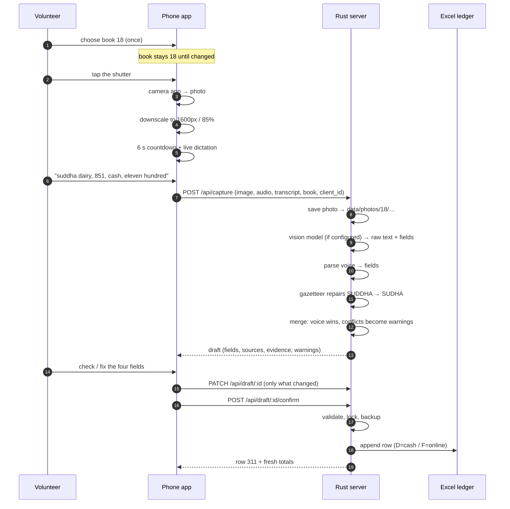

# Flow

One receipt, end to end. Everything below is implemented; the file names in
brackets are where to look.

## 1. Happy path



## 2. State machine (server draft)

```
                 capture
                   │
                   ▼
   ┌──────────► pending ──── confirm ───► committed
   │               │                          │
   │            reject                        │
   │               ▼                          │
   └────────── rejected                    (terminal)
                   │
                   └── confirm on a committed draft returns the same row (idempotent)
```

- `pending` → editable (`PATCH`), rejectable, confirmable.
- `committed` → immutable from the app; corrections happen in Excel.
- `rejected` → hidden from Recent, cannot be pushed.

## 3. App screen flow

```
 Capture ──photo──► Voice(6s) ──auto──► Sending ──ok──► Review ──push──► Success
    ▲                  │                                          │
    │                  └──Stop / mic blocked──────────┐            │
    │                                               ▼            │
    └────────────────── Retake ◄──── Error ◄──── upload fails    │
    └────────────────────────────────────────────── Next receipt ┘
```

Tabs: **Capture · Recent · Setup**. A reload during review restores the pending
draft from `sessionStorage` (the native camera app can kill the tab).

## 4. Field arbitration

| Field | 1st choice | 2nd | Fallback | Conflict handling |
|---|---|---|---|---|
| book | sticky setting | — | must be set, else 400 | never read from the image |
| receipt | voice | vision | empty → blocked at push | other reading in `alternates` + warning |
| name | voice → gazetteer | vision → gazetteer | empty → blocked at push | `vision read the name as X` |
| amount | voice | vision | empty → blocked at push | `vision read Rs X, you said Rs Y` |
| mode | voice | vision | **CASH** (blank on stub) | `you said online, vision saw cash` |

Manual edits replace the value, set `source=manual`, `confidence=1.0`, and clear the
conflict warnings. Evidence is kept for audit.

## 5. The 6-second voice window

```
t=0.0  photo accepted → build 1600px jpeg, preview shown
t=0.0  VoiceCapture.start(): getUserMedia → MediaRecorder.start()
t=0.0  SpeechRecognition.start() (en-IN, continuous, interim)
t=0..6 countdown ring, transcript streams into the box
t=6.0  hard stop (or the volunteer taps Stop earlier)
t=6.0  MediaRecorder.stop() → blob (~30 KB opus), tracks released
t=6.0  POST /api/capture
```

Microphone blocked (plain http, denied permission, no device): the countdown still
runs so the UI is predictable, the clip is simply absent, and the review screen
starts blank for typing. The capture is never blocked by a missing mic.

## 6. Server processing order

1. Deduplicate on `client_id` — a retried upload returns the first draft.
2. Validate photo magic bytes, book range.
3. **Persist** photo (and audio) — before any model call.
4. Vision model, 45 s cap. `NotConfigured` is normal, not an error.
5. If no transcript and audio exists → server STT, 20 s cap.
6. Parse voice, normalise name, merge, build warnings.
7. Persist the draft in SQLite. Return it.

Only step 8 (confirm) touches the ledger.

## 7. Failure modes

| Failure | What the volunteer sees | What survives |
|---|---|---|
| No book chosen | "Set the book number first" | nothing lost |
| Camera cancelled | shutter screen | nothing |
| Mic blocked | note + editable fields | photo |
| Vision model down / slow | "vision model failed / took too long" | photo, voice, manual entry |
| Wifi drops after capture | "Cannot reach the server" + Try again | nothing yet — the photo is still in the page |
| Server dies mid-push | 500; no row | original ledger + timestamped backup |
| Ledger file missing | warning at capture, error at push | draft stays pending |
| Two pushes of one draft | same row number twice | one row |
| Same receipt number captured twice | "R/851 in book 18 is already row 259" | nothing written |
| Phone reloads during review | same draft comes back | draft in SQLite |

## 8. Where things live after a receipt

```
data/
  photos/18/20261022-103716-baf4c7.jpg     the stub, as photographed
  audio/18/20261022-103716-9f21aa.webm     the 6 s clip
  puja.db                                  drafts + sticky book
  ledger/
    Durga Puja 2026.xlsx                   the book (only one row added; the file
                                           itself is re-serialised atomically)
    backups/Durga Puja 2026-20261022-103716.xlsx
```
